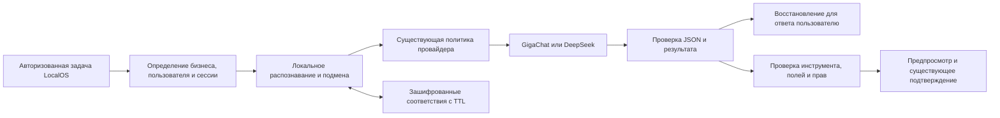

# LocalOS: пилот защиты данных перед внешними LLM

Статус: `beta`, обновлено 13.11.2026. На VPS включена защита текстового Оператора
в приложении и owner-боте Telegram через общий `process_chat`. Остальные AI-функции,
голос и файлы этим включением не охвачены. Обычный default в коде остаётся выключенным;
серверный файл активации включает только область `operator_text`.
[Текущая выкладка, проверки и ограничения](operator-activation-20261113.md),
[эксплуатация и аварийный барьер](operations.md).

Это обратимая псевдонимизация, а не необратимое обезличивание или подтверждение
юридического соответствия. Рабочие записи и схема БД вручную не изменялись;
приёмка использует синтетические данные и подменённые внешние LLM/бизнес-действия.

История: 02.11 — [установка под выключенным флагом](vps-deployment-20261102.md);
03.11 — [общий runtime и Redis](shared-runtime-20261103.md),
[подключение пяти процессов](shared-wiring-20261103.md) и
[сохранение конфигурации](shared-persistence-20261103.md);
04.11 — [публичный контекст, правила восстановления и нагрузка](operator-acceptance-20261104.md).
Попытка включения 04.11 была остановлена после потери доступа к VPS. Актуальный
статус включения и обнаруженное расхождение конфигурации описаны в отчёте 13.11.

## Решение

Выбран `piighost 2.1.1 + Presidio Analyzer 2.2.366` с компактными моделями spaCy
RU/EN и общими правилами LocalOS. Основание — [измерения](benchmark.md), а не
заявления README библиотек. [Сравнение](comparison.md), [угрозы](security.md),
[воспроизведение и конфигурация](deployment.md).

## Точки подключения

| Код | Ответственность |
|---|---|
| `src/services/pii_protection/engines.py` | Заменяемые адаптеры к настоящим piighost/Presidio и Preserve |
| `src/services/pii_protection/rules.py` | Размеченные поля, международные контакты, Unicode, банковские значения и секреты; объединение пересекающихся диапазонов |
| `src/services/pii_protection/name_context.py` | Контекстные имена в записи/переносе/контакте и повторные точные упоминания в текущем тексте |
| `src/services/pii_protection/public_context.py` | Позиционный серверный PublicSpan, связанный с бизнесом и источником |
| `src/services/pii_protection/operator_context.py` | Проверка доступа и привязки публичного снимка карточки, точные диапазоны в prompt и allowlist семи контрактов инструментов |
| `src/services/pii_protection/admission.py` | Общий и бизнес-лимит перед NLP; ограниченная память счётчиков, без исходных идентификаторов в статусе |
| `src/services/pii_protection/activation.py` | Область доверенного запроса, обязательная конфигурация, enforce/blocked и очистка контекста |
| `src/services/pii_protection/gateway.py` | Scope, шифрование, TTL, токены, доверенная граница восстановления, diagnostic и fail-closed |
| `src/services/llm/gateway.py` | Защита каждой попытки, correction retry и независимой shadow-задачи; восстановление ответа |
| `src/services/ai_spend_budget.py::guarded_post` | Проверка фактического текстового payload перед существующим бюджетом и HTTP-запросом |
| `src/services/operator_tool_loop.py` | Отдельное восстановление разрешённых аргументов после выбора разрешённого инструмента |
| `src/services/gigachat_client.py::upload_file_simple` | Запрет незащищённых загрузок изображений при включённом пилоте |

Gateway использует серверные `business_id`, `user_id`, `pii_session_id`. Последний
явно заполняется `conversation_id` для Operator. Для отдельных фоновых запросов
без сессии создаётся одноразовый случайный scope; `pipeline_id` не подменяет
авторизацию. Пустой бизнес или пользователь при включённой защите блокирует задачу.
Модель не может назначить себе scope. История остаётся в существующих таблицах
`operatormessages`, `operatorconversations`, `aiagentmessages` и связанных
сущностях: новый контур диалогов или лидов не создаётся.

Каждое значение получает непрогнозируемый HMAC-токен, связанный со scope и точным
значением. Регистр, падеж и разные record IDs не объединяются нечётким сравнением.
Одинаковые строки имён не доказывают тождество клиентов. Токены стабильны в сессии,
но принять можно только токен, выданный в текущем запросе/его внутренних попытках.
Входящие от пользователя строки вида `<<PII_...>>` отвергаются.

## Хранение и восстановление

Runtime требует общий Redis и отдельный Fernet-ключ. Ключи Redis и токены включают
HMAC scope; значения шифруются, срок жизни по умолчанию 900 секунд. Проверяется
также возраст ciphertext. Память процесса используется только явным тестовым
адаптером; автоматического fallback с Redis на память нет. Пароли и секреты
не входят в обратимое хранилище. Существующая политика блокировки credential-
задач сохраняется.

Обычные JSON-ответы восстанавливаются как дерево строковых значений с повторной
сериализацией: кавычки и обратные слеши не ломают JSON. Ключи с плейсхолдерами
запрещены; числовые и логические типы сохраняются. Вызовы инструментов в ответе
обычной текстовой задачи блокируются. Для Operator план остаётся подменённым;
`pii_restore_fields` задаёт серверный список разрешённых полей каждого инструмента.
Для семи проверенных контрактов список назначается серверным нормализатором;
для остальных он пуст. Разрешены только конкретные строковые поля. Scope, URL и название инструмента восстанавливать
нельзя. Просмотр разрешённого действия не означает его выполнение: внешние writes
остаются за существующим ручным подтверждением LocalOS.

Результаты инструментов и история вновь проходят защиту при следующем обращении
к модели. Streaming-декодер умеет собирать токены между чанками; живой потоковый
HTTP-маршрут LLM в этом пилоте не добавлен.

## Политики и охват

- `private`: персональные данные, частные адреса и внутренние организации.
- `public_geo` / `content`: разрешают PERSON/ORG/LOCATION внутри конкретных
  серверных PublicSpan для публичного названия/адреса. Общего исключения по одному
  NER-ярлыку или подписи Company больше нет. Частные явно обозначенные поля,
  контакты, реквизиты и секреты защищаются независимо от публичного диапазона.
- Политику выбирает серверный caller через `LLMTaskRequest.pii_policy`, не LLM.

`LLMTaskRequest.pii_public_context` — tuple объектов PublicSpan. Caller должен
сначала проверить источник и доступ к нему, затем привязать опубликованное значение
к точным символьным диапазонам окончательного prompt. Gateway проверяет бизнес,
тип, source_id, диапазон и совпадение значения; сам source_id через БД не проверяет.
Передавать контекст из пользовательского JSON или модельного ответа нельзя.
Одинаковая строка за пределами проверенного диапазона не получает исключение.
Повторные попытки сохраняют контекст; при изменении самого prompt диапазоны нужно
построить заново, иначе запрос блокируется. В тестах используется отдельная
синтетическая запись `tests/fixtures/pii/public_context.json`.

В общем обработчике веба и Telegram при включённой защите доступ повторно проверяет
`authorize_actor`. Затем читаются до пяти последних снимков `cards`, связанных
через `businessmaplinks` с тем же бизнесом и URL. Принимаются только сохранённые
названия/адреса HTTPS-карточек поддержанных доменов Яндекс/Google/2ГИС. Профиль
бизнеса и поля пользовательского payload исключения не создают. Значения
добавляются в отдельный участок окончательного prompt планировщика; разрешение
не распространяется на совпадения в сообщении, истории и других участках.
Контекст привязан к бизнесу и пользователю через ContextVar и очищается после
запроса. При выключенном флаге этот загрузчик не вызывается.

При включённой защите email больше не заменяется предварительными `@refN`:
он проходит общий PII-контур и восстановление полей. Серверные ссылки на ID
продолжают использовать прежний механизм. Черновики восстанавливают разрешённый
текст как preview; подготовка отправки/доступа/финансовой операции сохраняет
существующее подтверждение. Не содержащие PII-токенов аргументы проходят обычные
проверки инструмента без лишней попытки восстановления.

На 02.11.2026 исходные пропуски двух имён и три ошибки публичных названий устранены
на корпусе и дополнительных контекстных проверках. [Linux/Redis-измерения](benchmark.md)
проведены в отдельном контейнере с квотой 2 CPU / 4 GiB; это не полный production-стек.

При включении пилота прямые legacy-вызовы, embeddings и мультимодальные payloads
блокируются, если не проходят поддержанный текстовый маршрут. Это намеренный
ограниченный охват, а не обещание поддержки всех функций. Исходные фото, сканы,
голос и TTS требуют отдельной локальной обработки/политики: SpeechKit не становится
защищённым от добавления текстового шлюза.

Распознавание остаётся локальным. Загрузка моделей допускается только на этапе
установки. У Presidio заменена сетевая загрузка public suffix list на встроенный
снимок tldextract. У piighost отключены payload-трассировки даже при активном OTel.
OpenClaw не менялся: это защита бизнес-данных внутри LocalOS, без нового внешнего
коннектора, кампаний или исполнительного контура.

Источники действующих границ: [README](../../README.md), [SECURITY](../../SECURITY.md),
[LLM routing](../LLM_ROUTING_ROLLOUT.md), [OpenClaw](../OPENCLAW_CURRENT_STATE_20261012.md).
