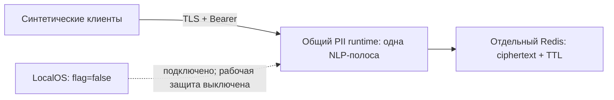

# Общий процесс PII и приватный Redis — 03.11.2026

Статус: `internal`, `wired_flag_off`. Контур поднят на VPS и проверен на синтетике.
После явного разрешения пользователя подключены app, worker, operator-worker,
outreach-worker и telegram-bot; они поочерёдно перезапущены и проверены.
Флаг рабочего LocalOS остаётся выключенным, сервер принимает только синтетические
scope. [Отчёт о подключении](shared-wiring-20261103.md).

Подключение затем закреплено в автоматическом `COMPOSE_FILE` VPS; будущие
пересоздания сохраняют клиентский mount и сети под выключенным флагом.
[Проверка постоянной конфигурации](shared-persistence-20261103.md).

Обновление 04.11.2026: установлены правила Оператора и квоты 10 protect/с суммарно,
4 protect/с на бизнес. Окончательный образ `20261104-v3` прогревает синтетический
RU/EN-цикл до готовности. Флаг выключен, synthetic-only сохранён.
[Сквозная приёмка, нагрузка и холодные запуски](operator-acceptance-20261104.md).

## Что работает

- `localos-pii-runtime`: один Gunicorn worker с одной NLP-полосой и общей копией
  компактных RU/EN-моделей piighost + Presidio. В клиентском процессе модели не загружаются.
- `localos-pii-redis`: самостоятельный Redis 7.4, отдельный от рабочего Redis LocalOS.
  Соответствия шифруются Fernet, ключи включают HMAC scope, TTL 900 секунд. Пароли и
  секреты исходных текстов не включаются в обратимое хранилище.
- Оба контейнера находятся только во внутренней сети `localos-pii-private`, без
  опубликованных host-портов и выхода в интернет. Root filesystem read-only,
  `cap-drop=ALL`, `no-new-privileges`, core dumps отключены.
- RPC использует TLS с частным CA и проверкой имени сервера плюс отдельный Bearer-токен.
  Испытан TLS 1.3. Перенаправления и HTTP не поддерживаются клиентом.
- Сервер принимает только scope, у которых business/user/session начинаются с
  `synthetic-`. Это ограничение идентификаторов; ответственность за происхождение
  самого текста остаётся у доверенного диагностического клиента.

Конфигурация контейнеров: [compose.yml](../../docker/pii-runtime/compose.yml).
Код API: [runtime_server.py](../../src/services/pii_protection/runtime_server.py),
клиент: [remote.py](../../src/services/pii_protection/remote.py).

## Контракт и отказ

Внутренний адрес: `https://localos-pii-runtime:8765`.

| Маршрут | Вход | Выход и ограничения |
| --- | --- | --- |
| `POST /v1/protect` | scope, text, policy, allowed_tokens, public_context | Подменённый текст, набор выданных токенов, число сущностей |
| `POST /v1/resolve` | scope, token | Исходное значение только при существующем соответствующем mapping |
| `POST /v1/status` | пустой JSON и авторизация | PID модели, счётчики, `synthetic_only` |
| `GET /health` | без данных | Проверка доступности Redis; без payload/секретов |

Текст ограничен 100000 символами, JSON — 512 KiB, public_context — 100 диапазонами,
число сущностей/разрешённых токенов — 2000. Сохраняются существующие Scope, PublicSpan
и Exchange-проверки. API не проверяет права пользователя через PostgreSQL: их проверяет
LocalOS перед вызовом. Автоматическое подключение реальных публичных записей и
`pii_restore_fields` в каталоге инструментов остаётся отдельной работой.

NLP-полоса одна, ожидание её освобождения ограничено 250 мс; затем возвращается
`PII_RUNTIME_BUSY`. Одновременно обслуживаются не более восьми HTTP-потоков, число
соединений ограничено. Зависший NLP-вызов завершает worker через watchdog (10 секунд),
Gunicorn также отслеживает остановившийся worker (20 секунд). Один worker создаётся
заново после завершения прежнего. Клиент не переключается на локальные модели или
plaintext и не повторяет транспортный запрос автоматически.

## Секреты и хранение

Секреты созданы непосредственно на VPS, каталог `/etc/localos/pii` — `0700`.
Значения не передавались в Git или отчёт. Клиенты получили только API-токен и
публичный CA; ключ шифрования mapping, приватные TLS-ключи и Redis credentials
в рабочие контейнеры не копировались.

| Файл | Доступ | Назначение |
| --- | --- | --- |
| `runtime.json` | `0400`, UID 10001 | Fernet-ключ, API-токен, доступ runtime к Redis |
| `client.json` | `0600`, root | Только URL, API-токен и публичный CA; без Fernet и Redis credentials |
| `server.key` | `0400`, UID 10001 | Приватный TLS-ключ сервера |
| `ca.key` | `0400`, root | Приватный CA; не монтируется в runtime |
| `users.acl`, `redis.conf` | `0400`, UID 999 | ACL с хэшами паролей и настройки Redis |
| `verify.json` | `0400`, UID 10001 | Только для отдельных синтетических проверок; не передаётся LocalOS |

Redis default-user выключен. Runtime разрешены только PING, GET/SET в
`localos:pii:v1:*`, SELECT и CLIENT SETINFO. Проверены отказы для чужих ключей,
CONFIG, FLUSHALL и KEYS. Отдельный диагностический пользователь имеет доступ
к этому же синтетическому namespace. AOF/RDB отключены, политика `noeviction`,
maxmemory 64 MiB, лимит контейнера 96 MiB. Slowlog отключён.

Основные секреты отсутствуют в Docker Config.Env/argv. Health-пароль отдельного
PING-пользователя читается из файла внутри healthcheck через `REDISCLI_AUTH`.
Проверены оба потока runtime-логов: секретов и проверенных тестовых строк в них нет.
Логгер Gunicorn выдаёт фиксированные коды без request path, payload и traceback.

Частично созданные при первом запуске TLS-файлы сохранены побайтово; восстановление
генерации дописало недостающие конфигурации. Удаление существующего ключевого материала
не выполнялось. TLS-сертификат действует до 01.02.2027; замена требует отдельной
операционной процедуры и повторения проверок доверия клиента.

## Проверки

**303 регрессионных теста + 5 сквозных HTTP-тестов, без ошибок и пропусков.**
Сквозной профиль прогнал все 200 сценариев через общий TLS-runtime и оба локальных
HTTP-макета LLM-адаптеров. Отдельно проверены 200 сценариев прямого RPC, сохранение
публичных диапазонов, чужие scope, неверные Bearer/CA, запрет обычных идентификаторов,
шифрование Redis, повреждение ciphertext и expiry одного созданного тестом mapping.

Ни одного внешнего LLM-вызова или подключения к рабочей БД в тестах не выполнялось.
Исходники/fixtures переданы по allowlist; credentials рабочего приложения не использовались.

### Нагрузка

Одна модельная полоса: 0.5 CPU / 640 MiB. Redis: 0.1 CPU / 96 MiB.
Нагрузочный клиент: 0.25 CPU / 192 MiB. Профиль использует фиксированную английскую
тестовую фразу с именем/телефоном/email и уникальные scope. Полный цикл включает
защиту, Redis и восстановление, исходный текст сверяется побайтово.

| Клиенты | Длительность | Успешно | Busy | p95, мс | Успешных запросов/с |
| ---: | ---: | ---: | ---: | ---: | ---: |
| 1 | 20 с | 310 | 0 | 100.373 | 15.441 |
| 4 | 20 с | 300 | 6 | 364.289 | 14.856 |
| 8 | 20 с | 243 | 249 | 480.064 | 11.965 |
| 4 | 300 с | 4464 | 87 | 348.040 | 14.868 |

При постоянной нагрузке четыре клиента получили около 1.9% контролируемых отказов
занятости; при восьми клиентах — около 50.6%. Это обнаруженный предел выбранных
квот/короткой очереди, а не нулевая доля ошибок или гарантия рабочей пропускной способности.
Неожиданных ошибок, неверных восстановлений и перезапусков модели во время нагрузки
не было. Для реального cohort нужны ограничение интенсивности и подходящая очередь.

Пик runtime: 551.4 MiB; Redis: 16.2 MiB. Минимальный MemAvailable VPS: 708 MiB.
Основной сайт отвечал 200 во всех 42 контрольных измерениях. Это шестиминутный
нагрузочный профиль с пятиминутным постоянным этапом, не многочасовой production soak.

### Отказы

1. Worker распознавателя остановлен SIGSTOP. Вызов полного LLM gateway завершился
   `policy_blocked / PII_RUNTIME_UNAVAILABLE`, вызовов макета провайдера — 0.
   Gunicorn восстановил worker; выданное до отказа соответствие восстановилось из Redis.
2. Остановлен только новый `localos-pii-redis`. Gateway завершился
   `policy_blocked / PII_RUNTIME_FAILED`, вызовов провайдера — 0.
   После запуска Redis потерянный volatile mapping вернул `PII_MAPPING_EXPIRED`.
   Новый прогон всех 200 сценариев прошёл успешно.

Основной Redis LocalOS не останавливался. На этапе нагрузочных проверок сеть,
секреты, исходники и перезапуски пяти рабочих consumers не менялись; тогда отдельно
зафиксировано пересоздание outreach-worker вне этих операций. После дополнительного
явного разрешения пользователя выполнено подключение пяти consumers, описанное ниже.
Материалы первоначального этапа в `shared-vps-20261103` сохранены как исторический срез.

## Подключение пяти consumers выполнено

Применены фабрика runtime и четыре новых модуля клиента/сервера, API-only секрет
и SHA-guarded откат. Выполнены следующие действия:

- сохранён предыдущий gateway и установлены только пять перечисленных PII-файлов;
- app, worker, operator-worker, outreach-worker и telegram-bot подключены к private-сети;
- установлен клиентский файл `0600`, без Fernet-ключа и Redis credentials;
- пять сервисов поочерёдно перезапущены в режиме без миграций;
- проверены выключенный флаг, отсутствие NLP в клиентах и общий PID распознавателя;
- из каждого клиента прошла синтетическая подмена и точное восстановление строки.

Первоначально автоматическая проверка разрешений отклонила подключение рабочего
контура; позднее пользователь разрешил именно эти действия. Первый проход откатился
из-за слишком ранней проверки HTTP после запуска app; повторный проход и независимая
проверка прошли. Рабочий флаг выключен, synthetic-only gate включён.

Текущие файлы клиентов скопированы в writable layer и сохраняются при restart.
Для будущего пересоздания контейнеров
[compose fragment](../../docker/pii-runtime/compose.client.fragment.yml) с read-only
mount уже добавлен в автоматический список конфигураций VPS.
[Подключение 03.11](shared-wiring-20261103.md),
[закрепление конфигурации](shared-persistence-20261103.md).

Результаты: [verification](results/shared-vps-20261103/verification.json),
[нагрузка и отказы](results/shared-vps-20261103/load-faults.json),
[безопасность](results/shared-vps-20261103/security-postflight.json),
[регрессия](results/shared-vps-20261103/regression/tests.xml),
[HTTP-профиль](results/shared-vps-20261103/shared-http/tests.xml).

Действующие границы: [архитектура](architecture.md), [безопасность](security.md),
[выкладка 02.11](vps-deployment-20261102.md).
Технические основания: [Gunicorn settings](https://gunicorn.org/reference/settings/),
[Redis ACL](https://redis.io/docs/latest/operate/oss_and_stack/management/security/acl/).
